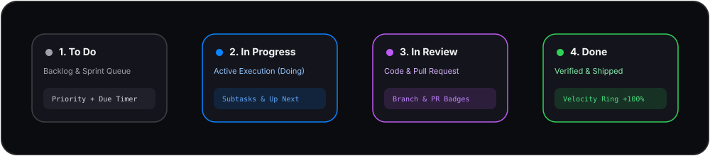

<div align="center">



<br />

<!-- Live Repository Traffic, Clones, Downloads & Community Health Badges -->
[](https://github.com/emirkefi/spider-web/releases)
[](https://github.com/emirkefi/spider-web/graphs/traffic)
[](https://github.com/emirkefi/spider-web)
[](https://github.com/emirkefi/spider-web/actions)
[](./LICENSE)
[](https://hyprland.org)

<p align="center">
  <strong>A blazingly fast, native GTK4/Wayland desktop Kanban &amp; Code Review workspace crafted for Hyprland Linux.</strong><br />
  Arrange tasks across <code>To Do</code>, <code>In Progress</code>, <code>In Review (Code)</code>, and <code>Done</code> with zero browser tabs, zero background servers, and full keyboard control.
</p>

<p align="center">
  <a href="#-key-features">Features</a> •
  <a href="#-animated-workflow-pipeline">Workflow</a> •
  <a href="#-quick-installation-native-desktop-app">Installation</a> •
  <a href="#-hyprland-compositor-integration">Hyprland Setup</a> •
  <a href="#-keyboard-shortcuts">Keybinds</a> •
  <a href="#-contributing">Contributing</a>
</p>

</div>

---

## ✨ Key Features

<table>
  <tr>
    <td width="50%">
      <h3>🕸️ 4-Stage Developer Kanban Board</h3>
      <p>Move tasks effortlessly across <strong>To Do</strong>, <strong>In Progress (Doing)</strong>, <strong>In Review (for Code)</strong>, and <strong>Done</strong> via smooth drag-and-drop or single-click stage advancement.</p>
    </td>
    <td width="50%">
      <h3>⚡ Standalone Native Linux Binary</h3>
      <p>Compiles directly into a self-contained ~390 KB <strong>GTK4 + WebKitGTK 6.0</strong> native Wayland executable (<code>./spiderweb</code>). No local server or external browser required.</p>
    </td>
  </tr>
  <tr>
    <td width="50%">
      <h3>🔍 Code Review &amp; Git Metadata</h3>
      <p>Attach Git branch names (<code>feat/layer-shell</code>), Pull Request links (<code>PR #118</code>), priority badges, and interactive subtask checklists directly to cards.</p>
    </td>
    <td width="50%">
      <h3>📊 Real-Time Velocity &amp; Completion Charts</h3>
      <p>Built-in SVG completion ring, pipeline stage distribution bar, per-project progress bars, and a <strong>Due Time Countdown Radar</strong> for approaching deadlines.</p>
    </td>
  </tr>
  <tr>
    <td width="50%">
      <h3>🧭 Collapsible Icon-Only Dock Sidebar</h3>
      <p>Switch seamlessly between a full zero-scroll workspace sidebar and a compact <code>68px</code> icon-only dock using <code>[</code> or <code>Ctrl + B</code>.</p>
    </td>
    <td width="50%">
      <h3>🌗 Frosted Glass Light &amp; Dark Modes</h3>
      <p>Translucent vibrancy surfaces, 1px hairline borders, high-contrast typography, and instant theme toggling with the <code>T</code> hotkey.</p>
    </td>
  </tr>
</table>

---

## 🔄 Animated Workflow Pipeline

<div align="center">
  
</div>

1. **To Do** — Queue upcoming engineering tasks with time estimates, priority tags, and due-time countdowns.
2. **In Progress (Doing)** — Focus on active work, check off granular subtasks, and pin top priorities to the **Up Next** queue.
3. **In Review (Code)** — Track open pull requests and branches awaiting verification before merging.
4. **Done** — Automatically updates your project completion percentages and sprint velocity charts.

---

## 🚀 Quick Installation (Native Desktop App)

### Prerequisites (Arch Linux / Hyprland)
Ensure you have `gtk4`, `webkitgtk-6.0`, `gcc`, and `nodejs` installed:

```bash
sudo pacman -S --needed gtk4 webkitgtk-6.0 base-devel nodejs npm
```

### Build & Install the Native Binary

```bash
# 1. Clone the repository
git clone https://github.com/emirkefi/spider-web.git
cd spider-web

# 2. Install UI build dependencies & compile the standalone native binary
npm install
npm run build:native

# 3. Install to ~/.local/bin/spiderweb and register desktop launcher + icon
./install-hyprland.sh
```

Once installed, launch it anytime directly from your terminal or app launcher (**Rofi / Wofi / Walker**):

```bash
spiderweb
```

---

## 🪟 Hyprland Compositor Integration

Add these rules to `~/.config/hypr/hyprland.conf` to summon **SpiderWeb** instantly with `SUPER + K` or as a toggleable floating scratchpad with `SUPER + ~`:

```ini
# Direct quick launch
bind = $mainMod, K, exec, ~/.local/bin/spiderweb

# Toggleable Special Workspace Scratchpad (Summon / Hide from anywhere)
bind = $mainMod, grave, togglespecialworkspace, spiderweb
workspace = special:spiderweb, on-created-empty:~/.local/bin/spiderweb

# Floating centered window rules
windowrulev2 = float, class:^(dev.hyprland.spiderweb)$
windowrulev2 = size 82% 85%, class:^(dev.hyprland.spiderweb)$
windowrulev2 = center, class:^(dev.hyprland.spiderweb)$
windowrulev2 = rounding 16, class:^(dev.hyprland.spiderweb)$
```

---

## ⌨️ Keyboard Shortcuts

Press **`?`** at any time inside the application to open the interactive **Keybinds Cheat Sheet** popup.

| Shortcut | Action |
| :--- | :--- |
| <kbd>Ctrl</kbd> + <kbd>K</kbd> | Open Command Palette (search tasks, jump stages, run commands) |
| <kbd>N</kbd> | Create a **New Task** in the active project |
| <kbd>P</kbd> | Create a **New Project** |
| <kbd>/</kbd> | Focus the Top-Right Search Bar |
| <kbd>[</kbd> or <kbd>Ctrl</kbd> + <kbd>B</kbd> | Toggle Sidebar between **Full View** and **Icon-Only Dock** |
| <kbd>T</kbd> | Toggle between **Light Mode** and **Dark Mode** |
| <kbd>?</kbd> | Open the **Keybinds Showcase Popup** |
| <kbd>Alt</kbd> + <kbd>1</kbd> | Switch to **Kanban Board** |
| <kbd>Alt</kbd> + <kbd>2</kbd> | Switch to **Up Next Queue** |
| <kbd>Alt</kbd> + <kbd>3</kbd> | Switch to **My Tasks** |
| <kbd>Alt</kbd> + <kbd>4</kbd> | Switch to **Progress & Velocity Charts** |
| <kbd>Esc</kbd> | Close any open modal or dialog |

---

## 📈 Download & Clone Tracking

This repository tracks community adoption automatically:
* **Release Binary Downloads:** Counted live via the **Total Downloads** badge at the top of this README whenever a release binary is downloaded from [GitHub Releases](https://github.com/emirkefi/spider-web/releases).
* **Git Clones Counter:** Tracked daily by `.github/workflows/clone-counter.yml`, which records cumulative `git clone` traffic into the `badges` branch so history is preserved beyond GitHub's default 14-day window.

---

## 🤝 Contributing

Contributions, issues, and feature requests are welcome! Please read our [Contributing Guidelines](./CONTRIBUTING.md) and [Code of Conduct](./CODE_OF_CONDUCT.md) before submitting a Pull Request.

## 📄 License

Distributed under the **MIT License**. See [`LICENSE`](./LICENSE) for full details.
