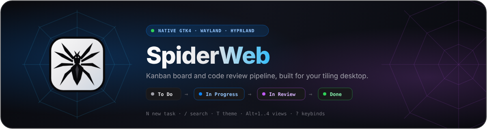
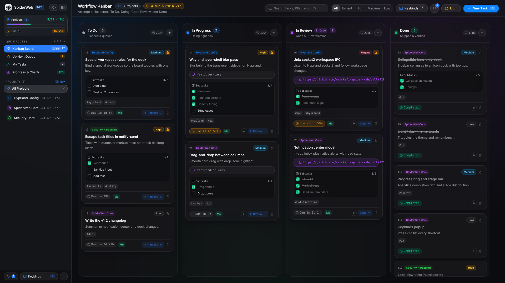
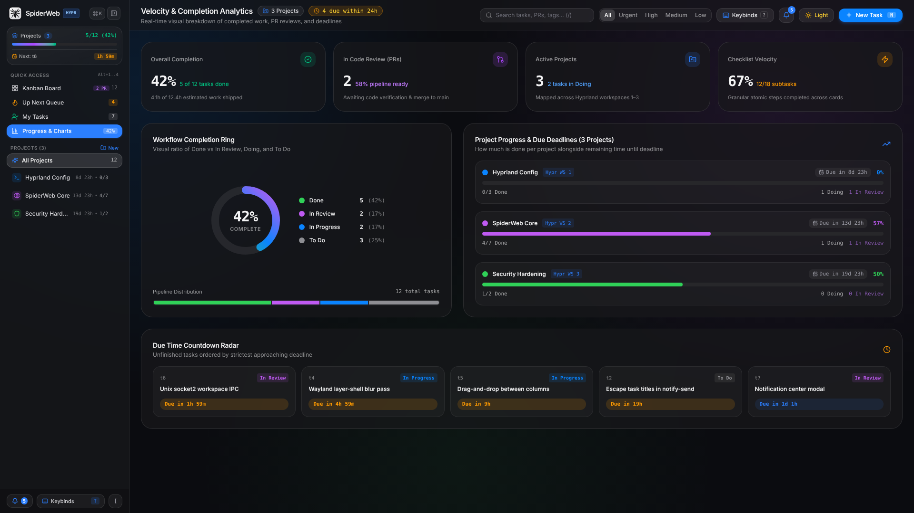
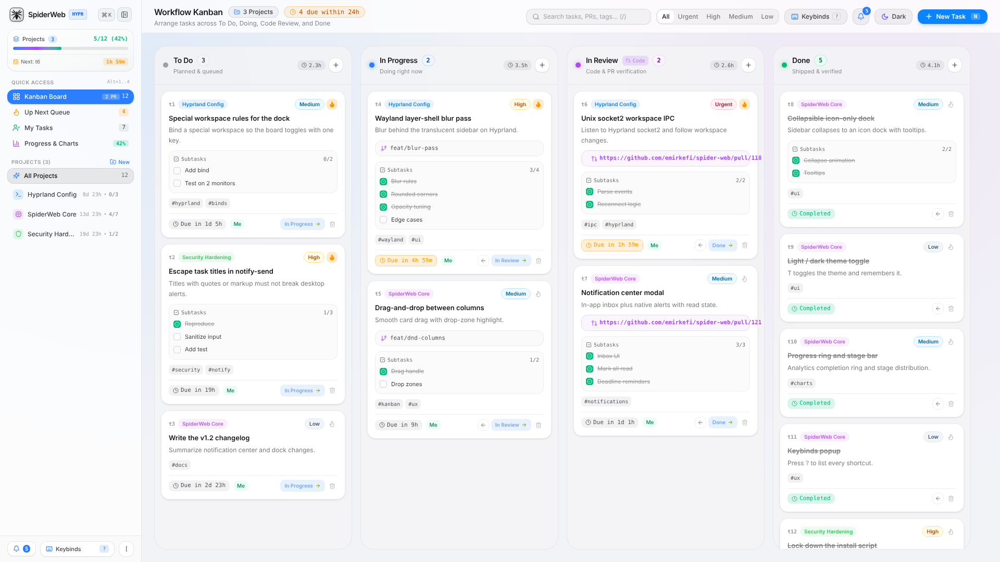

<div align="center">



<br />

[](https://github.com/emirkefi/spider-web/releases)
[](https://github.com/emirkefi/spider-web/graphs/traffic)
[](https://github.com/emirkefi/spider-web)
[](https://github.com/emirkefi/spider-web/actions)
[](./LICENSE)

<p align="center">
  <strong>Fast, native GTK4/Wayland Kanban &amp; Code Review desktop app for Hyprland Linux.</strong>
</p>

<br />



</div>

---

## Screenshots

<div align="center">
  
  
</div>

---

## Features

* **4-Column Kanban Board:** `To Do` -> `In Progress` -> `In Review (Code)` -> `Done` with drag-and-drop and 1-click stage buttons.
* **Iroh Peer-to-Peer (P2P) Sync:** Decentralized, zero-server real-time board synchronization built on **Rust + Iroh QUIC** (`iroh`, `iroh-gossip`). Share a Base64 **Board Invite Ticket** to sync tasks, projects, and team state across peers over direct QUIC hole-punching, mDNS LAN discovery, or encrypted relay fallback using conflict-free Last-Write-Wins (LWW) CRDTs.
* **Team & Role-Based Access Control (RBAC):** Manage users, groups, and granular role permissions (`Admin`, `Maintainer`, `Developer`, `Reviewer`, `Viewer`) with live avatar badges and permission enforcement.
* **Task Preview & Edit Modal:** Click any card to inspect or edit its title, description, stage, priority, due time, Git branch, PR link, tags, and interactive subtasks checklist.
* **Quick Access Views:** Switch between **Kanban Board**, **Up Next Queue**, **My Tasks**, and **Progress & Charts**.
* **Progress & Velocity Charts:** Completion ring, stage distribution bar, project progress bars, and a Due Time Countdown Radar.
* **Collapsible Sidebar:** Toggle between the full sidebar and an **icon-only dock** (`[`). Create or remove projects at any time.
* **Notifications Center:** In-app notification center and native Linux desktop push alerts (`notify-send`) for task creations, status updates, code reviews, and deadline reminders (`Alt+N`).
* **Top Right Controls:** Instant search (`/`), priority filter, **P2P Network status**, **Team RBAC modal**, **Keybinds popup (`?`)**, **Light / Dark mode toggle (`T`)**, and **New Task (`N`)**.
* **Standalone Desktop App:** Compiles into a native `./spiderweb` GTK4 binary paired with the `./spiderweb-core` Rust Iroh P2P networking daemon — no cloud account or browser needed.

---

## Iroh Peer-to-Peer (P2P) Connectivity

SpiderWeb includes a native **Rust Iroh P2P networking engine** (`spiderweb-core`) that automatically launches alongside the desktop app:

1. **Generate an Invite Ticket:** Open the **P2P Network** modal from the top bar or sidebar and click **Generate Board Ticket** to copy a signed Base64 connection ticket containing your cryptographic NodeId, relay URL, direct socket addresses, and gossip topic.
2. **Join a Remote Board:** Any peer on your LAN or across the internet can paste the ticket into **Join via Ticket** to establish an encrypted QUIC connection (`spiderweb/sync/1` ALPN) and perform an immediate CRDT state catch-up.
3. **Real-Time Gossip & Offline Catch-Up:** Task moves, edits, project changes, and RBAC updates broadcast live over `iroh-gossip` (`spiderweb/gossip/1`) and automatically reconcile via version vectors + Lamport timestamps if a peer reconnects after being offline.

You can also run a headless CLI peer for testing or always-on team syncing:
```bash
npm run p2p:cli -- --join <BASE64_TICKET>
```

---

## Workflow

<div align="center">
  
</div>

---

## Install & Run

```bash
# 1. Install dependencies (Arch Linux)
sudo pacman -S --needed gtk4 webkitgtk-6.0 base-devel nodejs npm rust

# 2. Clone & build native desktop app + Rust Iroh P2P core
git clone https://github.com/emirkefi/spider-web.git
cd spider-web
npm install
npm run build:native

# 3. Install spiderweb & spiderweb-core to ~/.local/bin & app launcher (Rofi / Wofi / Walker)
./install-hyprland.sh
```

Run anytime with:
```bash
spiderweb
```

---

## Hyprland Quick Launch

Add to `~/.config/hypr/hyprland.conf`:

```ini
bind = $mainMod, K, exec, ~/.local/bin/spiderweb
bind = $mainMod, grave, togglespecialworkspace, spiderweb
workspace = special:spiderweb, on-created-empty:~/.local/bin/spiderweb
```

---

## Keybinds

Press **`?`** inside the app to view the shortcuts popup.

| Key | Action |
| :--- | :--- |
| <kbd>Ctrl</kbd> + <kbd>K</kbd> | Open Command Palette |
| <kbd>[</kbd> or <kbd>Ctrl</kbd> + <kbd>B</kbd> | Hide / Show Sidebar (Icon-Only Dock) |
| <kbd>N</kbd> | New Task |
| <kbd>P</kbd> | New Project |
| <kbd>/</kbd> | Focus Search Bar |
| <kbd>T</kbd> | Toggle Light / Dark Mode |
| <kbd>Alt</kbd> + <kbd>N</kbd> | Toggle Notification Center |
| <kbd>?</kbd> | Show Keybinds Popup |
| <kbd>Alt</kbd> + <kbd>1..4</kbd> | Switch Views (Board / Up Next / My Tasks / Charts) |
| <kbd>Esc</kbd> | Close Modal |

---

## License

[MIT License](./LICENSE) | [Contributing](./CONTRIBUTING.md) | [Code of Conduct](./CODE_OF_CONDUCT.md)
